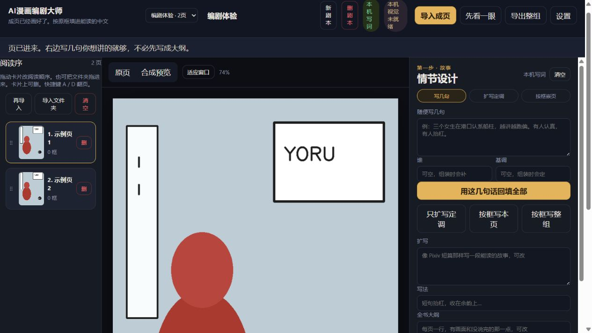

# yizi · 本机漫画对白工作台

一个在本机整理漫画成页、识别既有文字框并回填中文对白的工具。它处理已经画好的页面，不生成新页或新图。

> **和 [Manga-NAI-GPT](https://github.com/h1neolzr7f/Manga-NAI-GPT) 的区别**：Manga-NAI-GPT 做页内修图（换角色、改字幕擦字重嵌、去字、分层、AI 生图）。**yizi** 专注「已有字框上的编剧 / 嵌字」：读入成页 → 检出原文字框 → 写中文对白 → 独立文字层导出，不负责换角或重绘画面。

[v1.0.0 源码 Release](https://github.com/h1neolzr7f/yizi/releases/tag/v1.0.0) · [参与贡献](CONTRIBUTING.md) · [安全说明](SECURITY.md)



> 截图使用仓库自带的几何示例页，本机视觉与检测均关闭；没有加载私人漫画或调用外部编剧接口。

## 工作流程

1. 导入成页或文件夹并调整阅读顺序。
2. 检出页面已有的文字框。
3. 在本机将画面整理成场景卡。
4. 用本机草稿或可选的 OpenAI 兼容接口生成对白。
5. 在独立文字层中编辑并导出，不覆盖 `source.png`。

原图不发送给编剧接口；接口只接收场景卡、大纲和文字框版式。未配置 API Key 时仍可用本机草稿走完主流程。本机视觉模型和框检测模型也是可选能力。

## 安装与启动

环境：Windows 10/11、Python 3.11 或更高版本。

```bat
git clone https://github.com/h1neolzr7f/yizi.git
cd yizi
python -m venv .venv
.venv\Scripts\pip.exe install -r requirements.txt
.venv\Scripts\python.exe -m yizi
```

浏览器打开 `http://127.0.0.1:8766`。也可以双击 `start.bat`。

如需安装可选本机视觉依赖：

```bat
.venv\Scripts\python.exe scripts\setup_vision.py
```

设置、工程和模型位于本地 `user_data/`。该目录已被忽略，也不应出现在 Issue、PR 或发布包中。

## 测试

```bat
set YIZI_VLM=0
set YIZI_DETECT=0
.venv\Scripts\python.exe -m pytest -q
```

本次整理在禁用可选视觉与检测的条件下通过 **68 项测试**。远端基线缺少 `tests/__init__.py`，在存在同名第三方 `tests` 包的环境里会使 `tests.helpers` 解析失败；加入这个包标记是让测试稳定引用仓库 fixtures 的最小修复。详见 [docs/VALIDATION.md](docs/VALIDATION.md)。

## 项目结构

```text
yizi/                       FastAPI 应用、工程、视觉与排版逻辑
frontend/                   本地浏览器界面
tests/                      无外部模型的单元与接口测试
scripts/setup_vision.py     可选视觉环境安装
start.bat                   Windows 启动入口
```

## 隐私与边界

- 不要提交 `user_data/`、API Key、模型权重或私人漫画成页。
- 启用第三方编剧接口前，应确认服务方的数据与费用政策。
- 默认只监听本机地址；不要直接暴露到公网。

## 许可证

源码按 [MIT License](LICENSE) 发布。Manga-Bubble-YOLO 等可选模型遵守各自许可证，模型文件不因本仓库的 MIT 许可证而自动获得同样授权。
